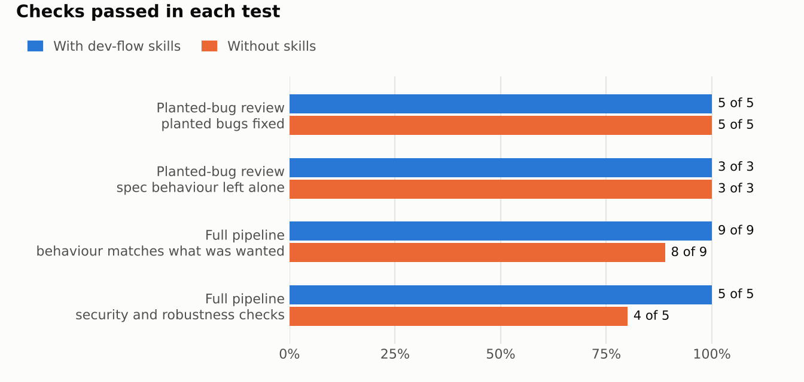
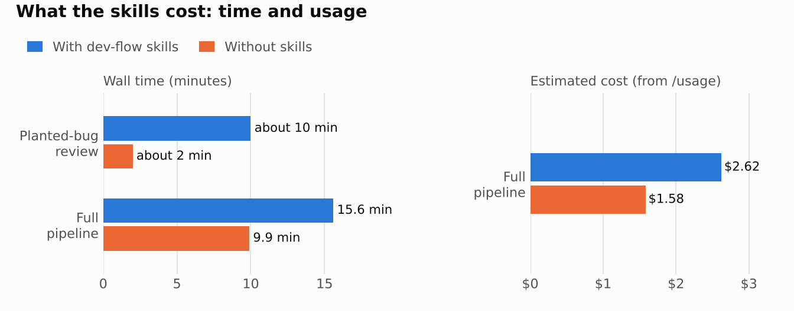

# dev-flow skills

Five skills for Claude Code that turn the main agent into an orchestrator: it asks until it understands the request, plans the work, and hands every implementation and review task to subagents with an assigned model and effort level.

The aim is production-ready code with fewer guesses, at a moderate cost in context and tokens.

## How it works

`/dev-flow <request>` runs these phases in order. Each phase is its own skill.

| Phase | Skill | What happens |
|---|---|---|
| 1. Plan | `dev-plan` | Reads the project, asks questions until it is about 95% sure what you want, drafts a task plan with file ownership, then asks for mode, git handling and plan approval. |
| 2. Implement | `dev-implement` | Hands each task to an implementation subagent, verifies the results by running the project's checks, retries a failure once, then asks you. |
| 3. Logic review | `dev-review-logic` | A reviewer subagent checks what was actually built against the plan and reports only issues it has verified. |
| 4. Security review | `dev-review-security` | Runs when the change touches a security-relevant surface (auth, user input, data access, secrets and so on); otherwise it is skipped with a one-line reason. |

`dev-flow` itself holds the rules all phases share and the pipeline that chains them.

Rules the orchestrator follows:

- **It never writes or reviews code itself.** Every change, including a one-line fix, goes to a subagent.
- **It asks instead of assuming.** Anything it would have to invent is a question for you.
- **It keeps messages short.** Questions, plans and code keep the detail they need; status updates and reports do not.
- **Critical and high review findings are fixed automatically** and re-checked by a second reviewer. Medium and low findings are listed and you choose.
- **Reviewers do not invent problems.** They report only what they can demonstrate with a file, a line and a failing scenario. "No issues found" is an accepted result.

### Modes

You pick a mode when you approve the plan.

| Mode | Implementation | Review |
|---|---|---|
| Economy | One subagent at a time | One reviewer per stage |
| Fast | Up to 3 subagents in parallel on tasks that share no files | Up to 3 reviewers per stage |

### Light review

A change of up to about 300 changed source lines (tests and docs not counted) gets one combined reviewer for logic and security instead of two separate stages. Larger changes get both stages.

### Model and effort per subagent

| Work | Model | Effort |
|---|---|---|
| Easy: mechanical, clear pattern to copy | opus | medium |
| Medium: several files or real design choices | opus | high |
| Hard or important: core logic, data integrity, auth | opus | xhigh |
| Exploration (read-only) | opus | medium |

Fable is offered only for the security review of important features and for the few most important implementation tasks, and only after you approve it. To use other models, edit this table in `skills/dev-flow/SKILL.md`.

## Install

Requires Claude Code. Setting effort per subagent needs v2.1.292 or later; on older versions dev-flow says so once and sets only the model.

```bash
git clone https://github.com/MrPengujn/dev-flow-skills.git
cd dev-flow-skills
./install.sh                         # personal skills, in ~/.claude/skills
./install.sh --project ~/code/myapp  # or: project skills, in myapp/.claude/skills
```

Or copy the folders in `skills/` into `~/.claude/skills/` yourself.

The skills are modular. `dev-flow`, `dev-plan` and `dev-implement` are the core. Leave out a review skill and the pipeline skips that stage and notes it in its final report:

```bash
./install.sh --without-security   # no security review
./install.sh --without-review     # no review at all
```

The skills are plain `SKILL.md` folders, so they also load anywhere else skills are supported. Where subagents are not available, dev-flow tells you and asks before continuing without delegation.

## Use

The skills load only when you invoke them.

```text
/dev-flow Add password reset to the API.
```

Each phase also works alone:

```text
/dev-plan Add CSV export of invoices.
/dev-review-logic Review the uncommitted changes against SPEC.md.
/dev-review-security Review the changes on this branch.
```

What to expect in a full run:

1. One or more rounds of questions about the feature.
2. A compact plan, then one round asking for approval, mode (economy or fast), git handling, and Fable approval if it was proposed.
3. Implementation by subagents. The plan lives in a temporary `.dev-flow/plan.md`, deleted at the end.
4. Review. Critical and high findings are fixed and re-checked without asking.
5. One question about any medium or low findings, then a short final report.

## Results

Two comparisons were run in Claude Code on a small dependency-free Node API, each once with the skills and once without. The main model was Opus 5.5 at xhigh effort in every run. The same person answered the agent's questions from a prepared answer sheet, and only when asked.

<picture>
  <source media="(prefers-color-scheme: dark)" srcset="assets/results-checks-dark.png">
  
</picture>

<picture>
  <source media="(prefers-color-scheme: dark)" srcset="assets/results-cost-time-dark.png">
  
</picture>

### Test 1: full pipeline from a vague request

Request: "Add password reset to the API." The wanted behaviour (endpoints, 15-minute single-use tokens, sessions revoked after a reset and so on) was on the answer sheet, so an agent learned it only by asking. Hidden scripts then checked the result.

| | Without skills | With skills |
|---|---|---|
| Behaviour matches what was wanted | 8 of 9 | 9 of 9 |
| Security and robustness checks | 4 of 5 | 5 of 5 |
| Project tests | 11 pass (4 new) | 16 pass (9 new) |
| Source lines changed | 214 | 68 |
| Questions asked | 3, in one round | 13, in four rounds |
| Estimated cost (`/usage`) | $1.58 | $2.62 |
| Wall time / API time | 9m 51s / 5m 24s | 15m 33s / 6m 35s |

The run without skills never asked about token lifetime and built 1 hour instead of 15 minutes. It also left existing sessions valid after a password reset. The run with skills asked about both and got both right. Its review was the light review: one combined reviewer, on Fable at medium effort, which found one low-severity issue.

### Test 2: review of a change with planted bugs

A ready-made feature was given to both runs with 5 hidden bugs (3 logic, 2 security) and 3 decoys: behaviour that looks wrong but follows the spec. The project's own tests passed, so the bugs could not be found by running them. The skills run used the two full review stages; the light review did not exist yet.

| | Without skills | With skills |
|---|---|---|
| Planted bugs fixed | 5 of 5 | 5 of 5 |
| Spec behaviour left alone (decoys) | 3 of 3 | 3 of 3 |
| Regression checks | 10 of 10 | 10 of 10 |
| Project tests | 28 pass (6 new) | 28 pass (6 new) |
| Questions asked | 0 | 2 |
| Wall time | about 2 min | about 10 min |
| Session usage | 1 percentage point | 2 percentage points |
| Requests | 9 | 46 |

Both runs fixed everything. Beyond the planted bugs, the run without skills fixed one extra real issue and made a few small refactors nobody asked for. The run with skills found that issue too, reported it as low severity and left it open as instructed, and found and fixed a second one the other run missed.

### What this does and does not show

- The skills paid off where the request was vague: asking first produced the behaviour that was wanted.
- On a small, well-specified review task they matched the plain run on the planted bugs at about five times the wall time.
- The skills cost more in every run: about 1.7 times the estimated cost on the pipeline test, and about twice the session usage on the review test.
- Each comparison is a single run on a small codebase, so treat the differences as indications, not measurements.
- Fast mode, large codebases and long multi-task features were not benchmarked.
- The run without skills in test 1 also applied a personal coding-style skill, which may have increased its line count.

## License

MIT. See [LICENSE](LICENSE).
